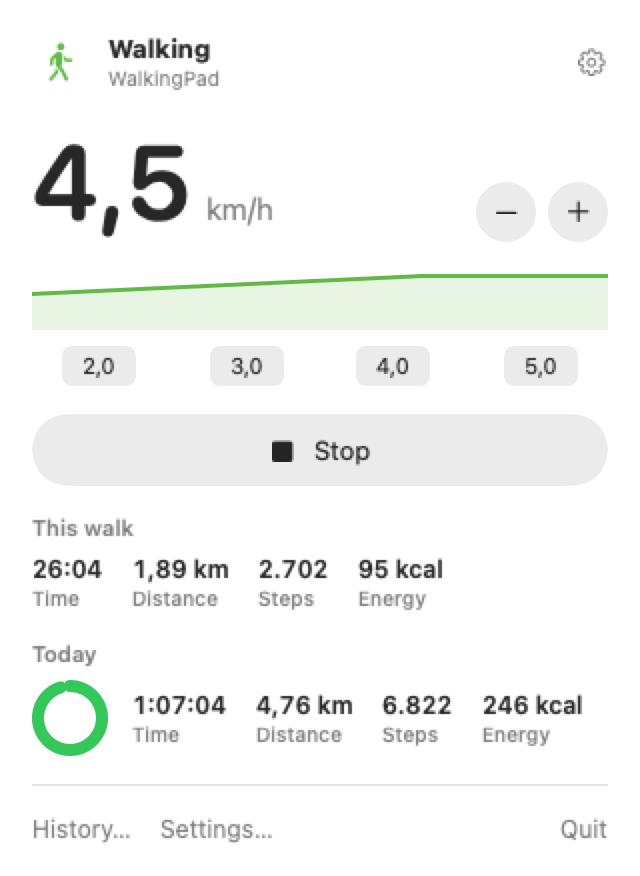
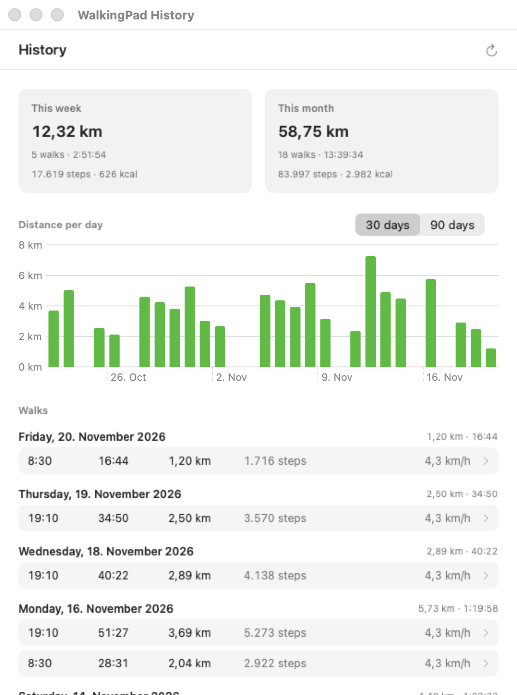
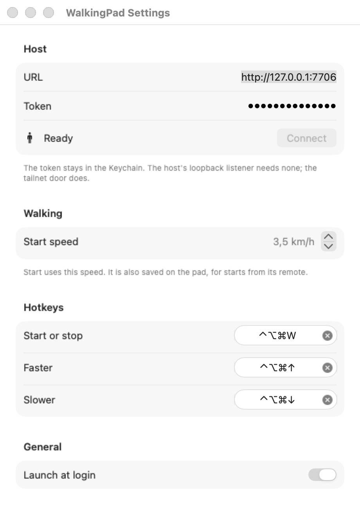

# walkingpad-mac

_Formerly `king-smith-walkingpad-mac`, renamed 2026-11-20._

Control and record a KingSmith **WalkingPad P1** treadmill from a Mac. A Go host on the Mac mini holds the Bluetooth link and the session history. A Swift menu bar app on the MacBook controls the belt and shows the history.

This is a personal tool, built and run by one person for one pad. The P1 speaks the WiLink protocol. That is the only model verified here. The source is public for reading, and for anyone with another pad: see [Other pads](#other-pads) before you start.

## What runs where

| Part | Runs on | Role |
|-|-|-|
| Host, `walkingpad` (Go) | Mac mini, LaunchAgent `com.jkrumm.walkingpad` | Owns the BLE link. Records sessions in SQLite. Serves the HTTP API on loopback. Syncs closed sessions to Argo. |
| Menu bar app, `WalkingPad.app` (`apple/`, Swift) | MacBook | Live speed, time and distance in the menu bar. Popover with start, stop and speed. Global hotkeys. History with charts. Talks to the host over HTTP only. |
| Raycast extension (`raycast/`) | Mac mini | The earlier controller. Reads the loopback API, so it works only where the host runs. Scheduled for removal once the app has run for 30 days. |

```
MacBook                                 Mac mini                 Pad
WalkingPad.app ──HTTPS──▶ TLS proxy ──▶ Go host ──BLE──▶ P1
                          (tailnet)        ├─▶ SQLite (source of truth)
                                           └─▶ Argo (optional)
```

The host process is the only Bluetooth client, and the app owns no database. The HTTP API is the only seam between them. The design and its open choices are in [docs/spec.md](docs/spec.md).

## Requirements

| | |
|-|-|
| Pad | KingSmith WalkingPad P1 |
| Host | Mac within Bluetooth range of the pad. Go 1.26 or newer to build. Tested on macOS 26, Apple Silicon. The bundle declares macOS 11 as its minimum. |
| Menu bar app | macOS 26 (the deployment target in `apple/project.yml`). Xcode to build it. `scripts/tools.sh` pins xcodegen and the Swift linters. |
| Raycast extension | Node 22.22.2 (`raycast/.nvmrc`), and only for `make up` or developing the extension. |

## Install the host

On the mini, from a clone:

```bash
git clone https://github.com/jkrumm/walkingpad-mac.git
cd walkingpad-mac
make deploy
make version
make verify
```

`make deploy` builds the binary with the commit sha stamped in and wraps it in `WalkingPad.app`. macOS denies Bluetooth to a bare binary, so the wrapper is required. It then:

1. Refuses unless the belt is stopped or in standby, so a restart never cuts a walk. `FORCE=1` overrides. If `/status` does not answer, it proceeds.
2. Keeps the bundle it replaces in `~/.local/state/walkingpad/rollback/`.
3. Installs `/Applications/WalkingPad.app`, installs the LaunchAgent on first run, and restarts it.

`make version` prints the live sha. `make verify` exits non-zero when `/health` does not answer. To go back one version, run `make rollback`.

On the first run macOS asks for Bluetooth access. Allow it. If the prompt was missed, grant it under **System Settings → Privacy & Security → Bluetooth**.

Signing: with a Developer ID identity in the keychain, the bundle keeps its Bluetooth grant across rebuilds. Without one it is ad-hoc signed, and macOS asks again after every rebuild. `SIGN_IDENTITY=-` forces ad-hoc.

`make up` runs `make deploy` and then starts the Raycast dev loop. Use it only when you work on the extension.

## Install the menu bar app

The app is built, signed and notarized on the mini, then copied to the MacBook. It needs the host URL and the remote token from [Remote listener and token](#remote-listener-and-token).

```bash
make app-release   # Release build, Developer ID, notarized, stapled
make verify-app    # signature, Hardened Runtime, staple, Gatekeeper
make install-macbook
```

`make app-release` holds the Apple build lock. Notarization can queue for up to 40 minutes, so run it in the background and read its log. `make install-macbook` runs on the mini. After you approve a dialog, it copies the bundle to `~/Applications/WalkingPad.app` on the MacBook, checks the signature, writes the host URL and token into the app, and relaunches it. The full procedure and its failure modes are in [docs/app-install.md](docs/app-install.md).

Without the dialog, copy the bundle yourself and enter the host URL and the token in Settings.

## Configuration

The host reads `~/Library/Application Support/WalkingPad/config.toml`. A missing file means defaults. `walkingpad config` prints the effective values with tokens redacted.

```toml
[device]
address = ""                  # BLE address pin; empty discovers the pad

[daemon]
http_port = 7706              # loopback API
poll_interval_ms = 1000       # 1000 at least: the pad drops frames above 1 Hz
log_level = "info"            # debug | info | warn | error
# remote_port = 7708          # >0 starts the token-guarded listener, see below

[session]
gap_minutes = 15              # a pause longer than this starts a new session
resume_within_seconds = 60    # a BLE drop shorter than this resumes the session
min_duration_seconds = 300    # standalone sessions shorter than this are discarded; 0 keeps all

[body]
weight_kg = 80.0              # input to the MET calorie estimate

[argo]
url = ""                      # the default points at the author's Argo API
token = ""                    # sync runs only with a token; KSWP_ARGO_TOKEN overrides
```

`argo.url` defaults to the author's Argo API. Without `argo.token`, the host sends nothing to Argo; `KSWP_ARGO_TOKEN` overrides the token. Sessions stay in the local database, and the app and Raycast still control the belt.

### Remote listener and token

The API listens on `127.0.0.1` only. With `remote_port` set, a second loopback listener starts. It answers 401 on every route, `/health` included, unless the request carries `Authorization: Bearer <token>`.

The token comes from `remote_token` in the config, else `KSWP_REMOTE_TOKEN`, else the generated file `remote-token` in the data directory. `walkingpad token` prints it. Keep it out of tracked files.

Put a TLS reverse proxy in front and make it reachable over your tailnet only. Never publish the port. Check it with reads:

```bash
curl -s -o /dev/null -w '%{http_code}\n' http://127.0.0.1:<remote-port>/status    # 401
curl -s -o /dev/null -w '%{http_code}\n' -H "Authorization: Bearer $(walkingpad token)" http://127.0.0.1:<remote-port>/status  # 200
```

## Usage

### Menu bar app

- **Menu bar:** speed, time and distance while the belt moves.
- **Popover:** belt state, speed up and down, start or stop, this walk and today's totals. Links to History and Settings.
- **Settings:** host URL and token (token in the Keychain), start speed (also saved on the pad), and the three global hotkeys: start or stop, faster, slower.
- **History:** totals for the week and the month, distance per day for 30 or 90 days, and the walks of each day.







These screenshots come from `make snapshots`, which draws every state against an in-memory host.

### Raycast

Commands: WalkingPad (menu bar), Controller, History, Set Speed, Speed Up, Speed Down, Start or Stop. The preferences set the daemon URL (default `http://127.0.0.1:7706`), the API token, the speed step and the default start speed.

### CLI

```bash
./bin/walkingpad scan       # nearby WalkingPad devices (BLE)
./bin/walkingpad config     # effective configuration, tokens redacted
./bin/walkingpad token      # the remote listener's token
./bin/walkingpad version
./bin/walkingpad connect    # its own BLE link, streams frames; debugging only
./bin/walkingpad serve      # the foreground daemon, what the LaunchAgent runs
```

The pad accepts one Bluetooth client. Run `connect` or `serve` only while the LaunchAgent is stopped. `launchctl bootout gui/$(id -u)/com.jkrumm.walkingpad` stops it. `launchctl bootstrap gui/$(id -u) ~/Library/LaunchAgents/com.jkrumm.walkingpad.plist` starts it again.

### HTTP API

```bash
curl http://127.0.0.1:7706/status
curl "http://127.0.0.1:7706/sessions?limit=10"
curl "http://127.0.0.1:7706/summary?period=week"     # today | week | month | all
curl "http://127.0.0.1:7706/summary/days?from=2026-11-01&to=2026-11-22"
```

| Method and path | Purpose |
|-|-|
| `GET /health` | Version. The loopback listener needs no token; the remote listener requires one on every route. |
| `GET /status` | Belt state, speed, distance, connection |
| `POST /start` | Body `{"speed_kmh": 3.5}` optional. Waits about 4 to 5 s for the 3-2-1 ramp, then sets the speed. |
| `POST /stop`, `POST /speed` | Stop; set speed in `0.5`–`6.0` km/h. Speed returns 503 when the pad is not connected. |
| `POST /pref/start-speed` | Start speed saved on the pad |
| `GET /sessions`, `GET /sessions/{uuid}` | Session list (`limit`, `before`) and one session |
| `GET /summary`, `GET /summary/days` | Totals per period; per day for a range of at most 366 days |
| `POST /sync/argo` | Sync now. Returns 503 without a token. |

`POST /start`, `POST /stop` and `POST /speed` move the belt. Do not send them to test anything. The full contract, with response shapes, is in [docs/protocol.md](docs/protocol.md) section 8.

## Architecture

One Go process owns the BLE link. CoreBluetooth allows one connection per peripheral. Every other consumer talks HTTP.

- **Session grouping:** pauses up to `gap_minutes` stay in one session. A drop shorter than `resume_within_seconds` resumes it.
- **Argo sync:** closed sessions upload every 60 s, and at startup the host reconciles orphans. While a session is open, the host pushes a live snapshot to Argo once per second.
- **Storage:** `~/Library/Application Support/WalkingPad/db.sqlite`. Closed sessions are marked as synced after upload.

The BLE protocol, the schema and the grouping rules are in [docs/protocol.md](docs/protocol.md). The BLE gotchas that fail silently are in [internal/AGENTS.md](internal/AGENTS.md).

## Troubleshooting

| Symptom | Cause and fix |
|-|-|
| `make scan` finds nothing | Bluetooth permission for `WalkingPad.app` is missing or off. Check **System Settings → Privacy & Security → Bluetooth**. |
| Daemon runs, no status frames | The pad is in standby. Press a button on the remote, then retry. |
| `address already in use` on 7706 | Another process holds the port. `lsof -nP -iTCP:7706 -sTCP:LISTEN` shows it. Restart the agent with `launchctl kickstart -k gui/$(id -u)/com.jkrumm.walkingpad`. |
| `make deploy` refuses | The belt is not stopped or in standby. Wait for the walk to end, or `FORCE=1 make deploy` if a restart is acceptable. |
| Speed command has no effect | The pad drops a speed set while it is stopped or ramping. Set the speed with `POST /start`, or send `POST /speed` while the belt is active. |
| Sessions missing in Argo | Check `[argo]` in the config and `make logs` for `sync.*` lines. Closed sessions upload on the sync interval (see Architecture). `POST /sync/argo` forces a run. |
| Session split by a BLE drop | Drops longer than `resume_within_seconds` close the session at the drop time. Tune `[session]`. |
| App shows unconfigured or unreachable | Enter the host URL and token in Settings. The host must answer on that URL from the MacBook. |

## Development

```bash
make              # the target list
make check-fast   # gofmt, vet, golangci-lint, Go and Raycast tests, Swift lint and tests; no Xcode
make check        # check-fast plus the Xcode build of the app (CI runs this)
make test         # Go race tests and Raycast typecheck
make snapshots    # draw the popover, Settings and History in every state, light and dark
make contracts    # rewrite contracts/fixtures after an intended API change
make logs         # bounded tail of the daemon logs; no follow mode
make fmt          # gofmt, go mod tidy, swift format
make scan         # BLE discovery (dev tool)
make clean        # remove ./bin
```

Read [AGENTS.md](AGENTS.md) before changing anything, [internal/AGENTS.md](internal/AGENTS.md) before touching the Go host, and [apple/AGENTS.md](apple/AGENTS.md) before touching the app.

## Other pads

Only the P1 is verified here. For another model, first find out which protocol it speaks, then pick from these projects:

| Project | Covers | License |
|-|-|-|
| [ph4r05/ph4-walkingpad](https://github.com/ph4r05/ph4-walkingpad) | Python reference for the WiLink protocol. This repo's protocol notes trace back to it. | MIT |
| [mcdax/walkingpad-controller](https://github.com/mcdax/walkingpad-controller) | WiLink and FTMS in one Python wrapper, with the most complete protocol notes | MIT |
| [tim-oster/walkingpad](https://github.com/tim-oster/walkingpad) | Go desktop controller, verified on the P1 on Apple Silicon. The app bundle template comes from it. | MIT |
| [Palmetto-Interactive-LLC/boardwalk](https://github.com/Palmetto-Interactive-LLC/boardwalk) | Mac app for FTMS under-desk treadmills: on, off, faster, slower | MIT |
| [k0siara/walkingpad-macos](https://github.com/k0siara/walkingpad-macos) | SwiftUI menu bar remote for WalkingPad and Kingsmith treadmills | none declared |
| [klassm/walkingpad_macos_client](https://github.com/klassm/walkingpad_macos_client) | Status bar app for Kingsmith WalkingPads. Last published 2022. | Apache-2.0 |
| [fortun8te/z1-walkingpad](https://github.com/fortun8te/z1-walkingpad), [slandau3/z1-walkingpad-mcp](https://github.com/slandau3/z1-walkingpad-mcp) | Z1 model: FTMS behind a vendor handshake, with a menu bar app and an MCP server | MIT (both) |

Closed source, for comparison: **WalkingMate** by Raine Virta, a Mac App Store app for menu bar control, keyboard shortcuts and workout tracking, with an iOS companion for Apple Health. Listed at `$4.99` when checked. [App Store listing](https://apps.apple.com/us/app/walkingmate/id6754256683?mt=12), [product page](https://walkingmate.zendit.fi/).

## Non-goals

No Garmin upload: Garmin Connect cannot change the watch's daily step count from manual activities. Start "Indoor Walking" on the watch if you want that. No Apple Health export and no FTMS support in this project. The P1 does not speak FTMS.

## License

[AGPL-3.0](LICENSE).
